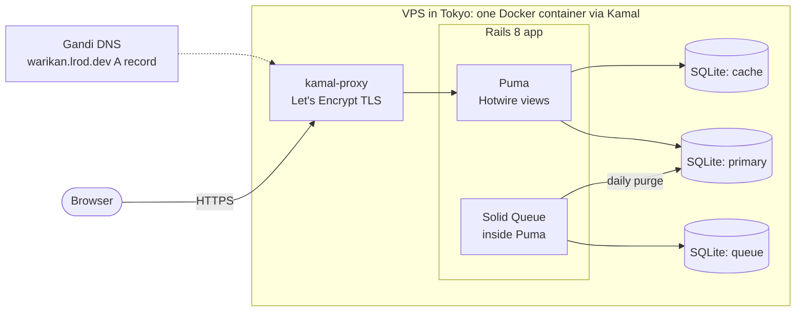
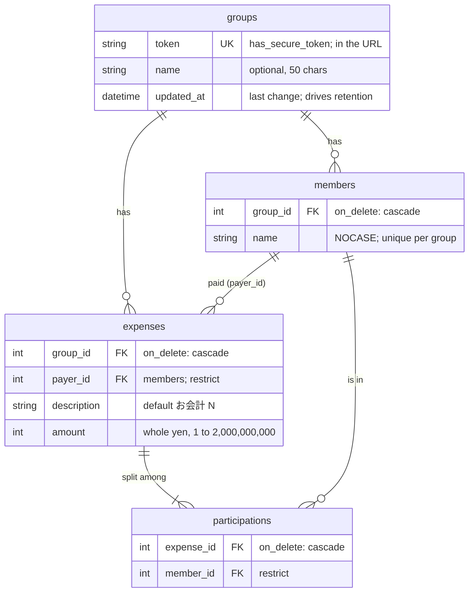
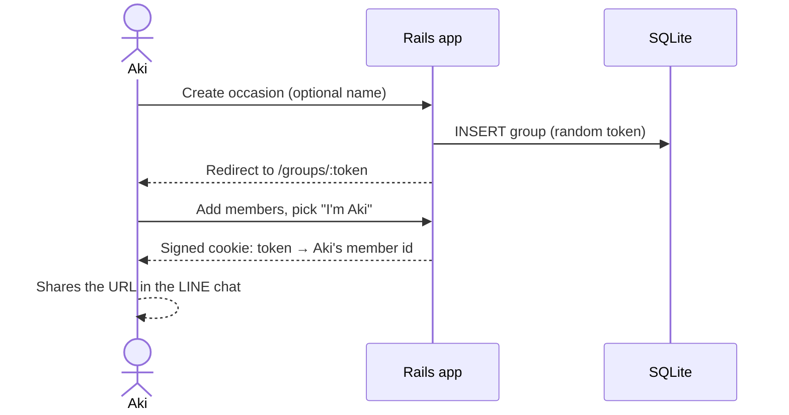

# Architecture

okanjo is a shared-expense splitting app for single occasions (a 飲み会, a trip). Users see
it as **warikan (割り勘)** at `warikan.lrod.dev`; okanjo is the codebase name (ADR 0017).
Decisions are recorded in [`docs/adr/`](adr/README.md), and this document summarises them.

**Status (2026-10-30):** the domain model is built and tested. Everything marked
*planned* is designed but not implemented yet.

| Area | Status |
|---|---|
| Domain model: groups, members, expenses, split shares | built |
| Routes, controllers and forms (session 2) | planned |
| Balance sheet, settlement, Turbo Stream update (session 3) | planned |
| Printable receipt, purge job, deploy (session 4) | planned |
| Phase 2: auth generator, JSON API, LIFF client, LINE Login | planned, after the core ships |

## System context

- **One process, no Redis, no Node.** The Rails 8 defaults (Solid Queue, Solid Cache,
  Propshaft, importmap) keep the whole app in one container backed by SQLite files on a
  Docker volume (ADR 0002, 0017).
- **Server-rendered HTML.** ERB views with Turbo and Stimulus. No JSON API in the core
  (ADR 0003).
- **No login in the core.** An occasion's URL token is its only access control. A signed
  cookie remembers which member this browser is in each occasion (ADR 0005, 0006, 0016).

## Domain model

- **A group is one occasion.** Every calculation creates a new one, and members don't carry
  over between occasions (ADR 0004, 0005, 0006).
- **Shares aren't stored.** `participations` has no amount. Each share is the amount divided
  by the number of members in the split, rounded up (`Integer#ceildiv`). The payer is
  credited with what's collected and keeps the odd yen (お釣り): ¥1,000 split 3 ways is
  ¥334 each, ¥1,002 collected, ¥2 kept by the payer (ADR 0008).
- **The payer doesn't have to be in the split** (e.g. a non-drinker paying the drinks
  tab). Payer and split members must belong to the expense's group (ADR 0015).
- **Last change.** Members, expenses and split entries `touch` their parent, so
  `groups.updated_at` moves forward on any edit. That includes removing someone from a
  split, which needs `dependent: :destroy` on the `has_many :through`.

### Where the logic lives (ADR 0009)

| Logic | Lives in | Status |
|---|---|---|
| One expense's share, collected amount, odd yen | `Expense` model | built |
| A group's balances (collected minus owed, per member) | plain Ruby query object, 2 queries | planned |
| Who pays whom | plain Ruby settlement object, from the balances | planned |

## Key flows

### Create an occasion and share it *(planned)*

### Add an expense and settle up *(planned)*

1. Someone adds an expense: description (pre-filled お会計 N), amount, payer (defaults to
   this browser's member), and who's in the split (everyone by default). Leaving the payer
   out of the split asks for confirmation, stating the effect in yen (ADR 0015).
2. The balance panel updates in place with a Turbo Stream.
3. **Settlement goes through one collector:** the member with the largest positive
   balance (ties go to whoever joined first). Every other member makes at most one
   transfer, to or from the collector. That's at most n−1 transfers, chosen because
   people trust "pay the 幹事", not because it's the fewest possible (ADR 0013).

### Retention and the purge job *(planned)*

- An occasion is deleted **30 days after its last change**. Viewing doesn't count. The
  occasion page shows the deletion date, and the printable receipt is how users keep a
  record (ADR 0016).
- A daily Solid Queue recurring task (`config/recurring.yml`) deletes stale groups with
  `Group.where(updated_at: ...30.days.ago).delete_all` (ADR 0012).

### Two deletion routes

| Route | Used by | How children go | Callbacks |
|---|---|---|---|
| `group.destroy` | user-triggered deletes | `dependent: :destroy`, expenses before members | run |
| `delete_all` | the purge job | database `ON DELETE CASCADE` | skipped, deliberately |

A member who paid for something or is in a split can't be deleted on their own
(`restrict_with_error`).

## Deployment and CI

- **Deploy *(planned)*:** Kamal 2 to a Tokyo VPS (provider TBD) as the last step of the
  core. kamal-proxy gets Let's Encrypt certificates. `.dev` is HTTPS-only, so TLS is on from
  the first deploy. Kamal's local registry pushes the image over SSH (ADR 0017).
- **Database:** SQLite files in `storage/` on a Docker volume, with separate databases for
  primary data, the cache and the queue.
- **Seeds:** the night-out demo, for development and test only. `db:prepare` would
  otherwise seed a fresh production database.
- **CI:** GitHub Actions runs Brakeman, bundler-audit, the importmap audit, RuboCop, RSpec,
  and system specs in headless Chrome. `bin/ci` runs the same checks locally (ADR 0014).

## Phase 2 *(planned, after the core ships)*

1. The Rails 8 auth generator (email + password, sessions) and a nullable
   `Member.user_id`.
2. A JSON API next to the HTML app.
3. A small LIFF client, likely served from a path on the same domain so it shares session
   cookies.
4. LINE Login as a second strategy on the same `User`, reusing the generator's session code.

This needs its own ADR first. The core keeps running on its own (ADR 0016, 0017).
