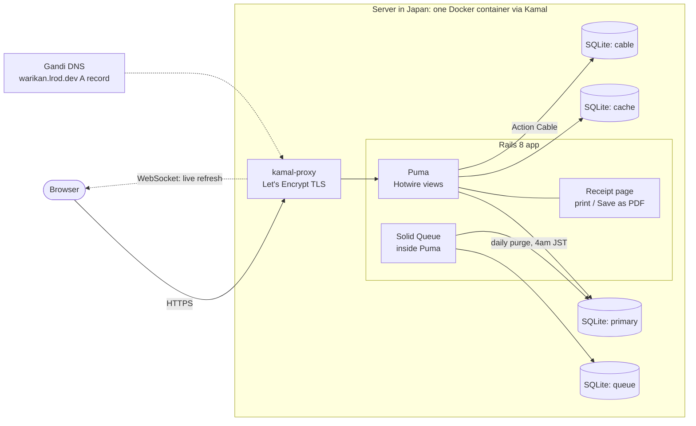
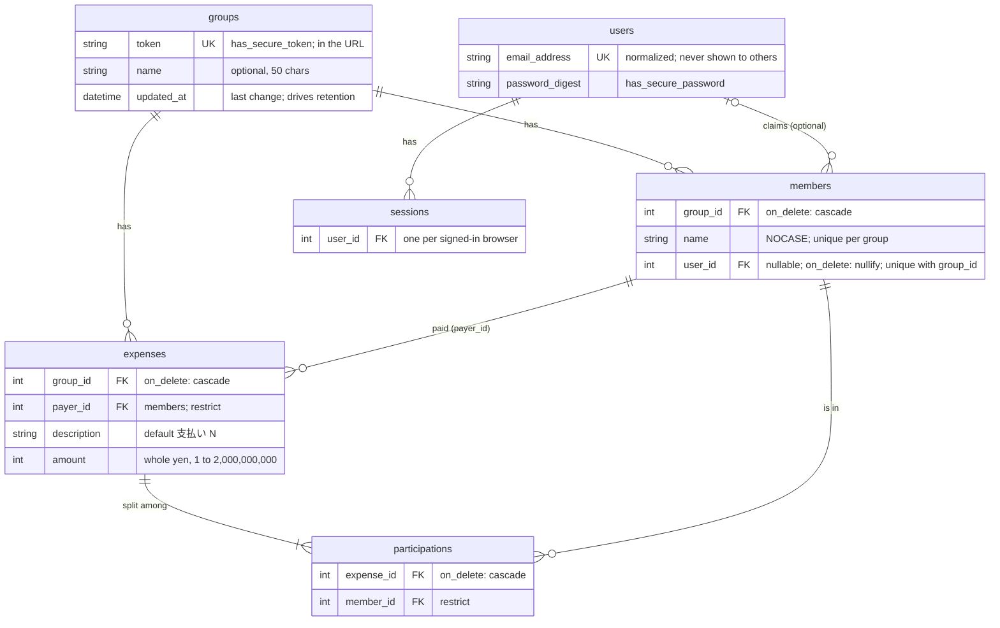
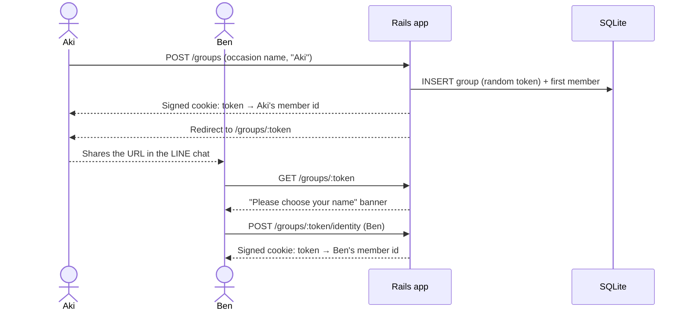
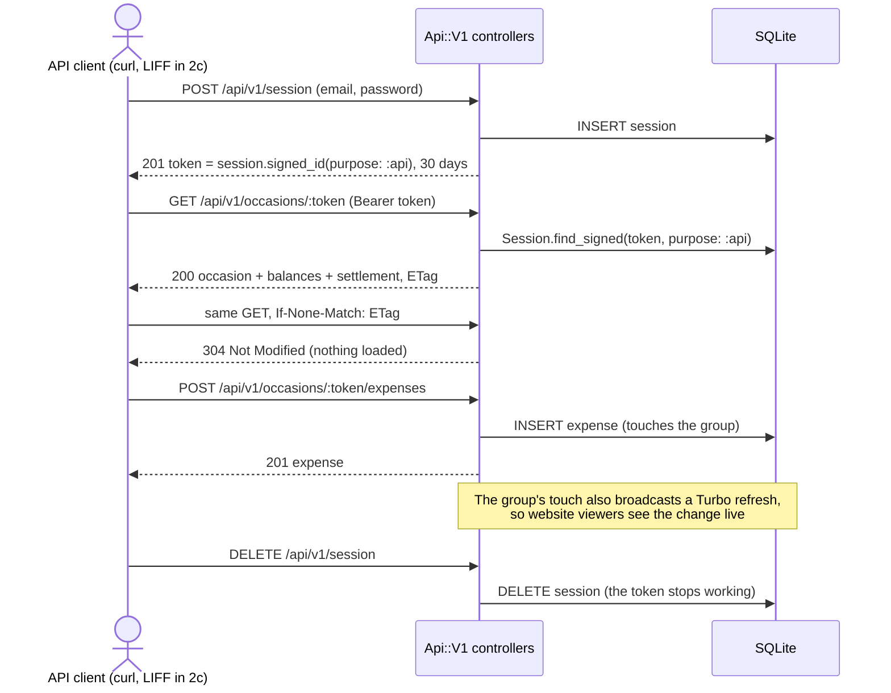

# Architecture

okanjo is a shared-expense splitting app for single occasions (a 飲み会, a trip). Users see
it as **warikan (割り勘)** at `warikan.lrod.dev`; okanjo is the codebase name (ADR 0017).
Decisions are recorded in [`docs/adr/`](adr/README.md), and this document summarises them.

**Status (2026-11-18):** the core is built, tested and **live at https://warikan.lrod.dev**:
the domain model, the core flow, balances, settlement, live refresh, the printable receipt
and the purge job. Phase 2 is live too: optional accounts (2a), the JSON API (2b), and the LINE
front end with LINE Login (2c). Everything marked *planned* is designed but not implemented yet.

| Area | Status |
|---|---|
| Domain model: groups, members, expenses, split shares | built |
| Routes, controllers and forms (session 2) | built |
| Balance sheet, settlement, live refresh (session 3) | built |
| Printable receipt, purge job (session 4) | built |
| Deploy (session 4) | live since 2026-11-13 |
| Phase 2a: optional accounts (ADR 0022) | live since 2026-11-13 |
| Phase 2b: JSON API at `/api/v1` (ADR 0023) | live since 2026-11-17 |
| Phase 2c-1: warikan v1 moved in, served at `/liff` (ADR 0024) | live since 2026-11-18 |
| Phase 2c-2: LINE Login, linking, the LIFF app on the API (ADR 0024) | live since 2026-11-18 |
| Phase 3: security and limits | planned |

## System context



- **One process, no Redis, no Node.** The Rails 8 defaults (Solid Queue, Solid Cache,
  Propshaft, importmap) keep the whole app in one container backed by SQLite files on a
  Docker volume (ADR 0002, 0017).
- **Server-rendered HTML.** ERB views with Turbo and Stimulus. No JSON API in the core
  (ADR 0003); phase 2 adds one beside it, with its own controllers (see [The API](#the-api-live)).
- **Live refresh.** Every change to an occasion broadcasts a Turbo page refresh over Action
  Cable (Solid Cable in production), and other viewers' pages morph in place (ADR 0019).
- **No login in the core.** An occasion's URL token is its only access control. A signed
  cookie remembers which member this browser is in each occasion (ADR 0005, 0006, 0016).

## Domain model



- **A group is one occasion.** Every calculation creates a new one, and members don't carry
  over between occasions (ADR 0004, 0005, 0006).
- **Shares aren't stored.** `participations` has no amount. Each share is the amount divided
  by the number of members in the split, rounded up (`Integer#ceildiv`). The payer is
  credited with what's collected and keeps the odd yen (お釣り): ¥1,000 split 3 ways is
  ¥334 each, ¥1,002 collected, ¥2 kept by the payer (ADR 0008).
- **The payer doesn't have to be in the split** (e.g. a non-drinker paying the drinks
  tab). Payer and split members must belong to the expense's group (ADR 0015).
- **Last change.** Members, expenses and split entries `touch` their parent, so
  `groups.updated_at` moves forward on any edit. That includes removing someone from a
  split, which needs `dependent: :destroy` on the `has_many :through`.
- **Accounts are optional (ADR 0022).** A user claims at most one member per occasion. A
  claim is for listing your occasions on any device, not for access: the link still opens
  the occasion for anyone. Occasions are still deleted 30 days after the last change.

### Where the logic lives (ADR 0009)

| Logic | Lives in | Status |
|---|---|---|
| One expense's share, collected amount, odd yen | `Expense` model | built |
| A group's balances (credited minus owed, per member) | `BalanceSheet`, plain Ruby, 3 queries | built |
| Who pays whom | `Settlement`, plain Ruby, from the balances | built |

`BalanceSheet` and `Settlement` live in `app/models/` with no table: in Rails a model is a
domain object, with or without a database table, and the folder is autoloaded. That's the
Rails-core and 37signals habit, instead of inventing an `app/services/` convention.

## Key flows

### Create an occasion and share it *(built)*



- Every route is nested under the token, and every record is loaded through the occasion
  (`GroupScoped`), so another occasion's ids are a 404.
- The cookie is a convenience, not security: it defaults the payer and marks "you". It
  also lists this browser's recent occasions on the start page (`CurrentMember`).

### Add an expense and settle up *(built)*

1. Someone adds an expense: description (pre-filled 支払い N), amount, payer (defaults to
   this browser's member), and who's in the split (everyone by default). Leaving the payer
   out of the split asks for confirmation, stating the effect in yen (ADR 0015).
2. **Everyone viewing the occasion sees it.** The expense touches the group, the group
   broadcasts a Turbo refresh over Action Cable, and each viewer's page morphs in place.
   A `keep-edits` Stimulus controller stops the morph from wiping a field someone is
   typing in (ADR 0019).
3. **The 精算 (settle up) section** shows each member's fronted and owed amounts and
   balance (`BalanceSheet`, 3 queries whatever the size), then who pays whom.
   **Settlement goes through one collector:** the member with the largest positive
   balance (ties go to whoever joined first). Every other member makes at most one
   transfer, to or from the collector. That's at most n−1 transfers, chosen because
   people trust "pay the 幹事", not because it's the fewest possible (ADR 0013).

### Retention and the purge job *(built)*

- An occasion is deleted **30 days after its last change**. Viewing doesn't count. The
  occasion page shows the deletion date, and the printable receipt is how users keep a
  record (ADR 0016).
- `PurgeStaleGroupsJob` runs as a Solid Queue recurring task (`config/recurring.yml`,
  `every day at 4am Asia/Tokyo`, production only). It runs `Group.stale.delete_all`: one
  `DELETE` statement, with the children removed by the database cascades (ADR 0012).
- `Group.stale` is strictly older than 30 days (`...RETENTION.ago`), so an occasion is never
  deleted before the date its page shows. A missed run catches up the next day.

### The receipt *(built)*

`GET /groups/:token/receipt` shows every expense with who was in its split, the total,
the balances and the transfers, laid out for paper. A Stimulus `print` controller calls
`window.print()`, Tailwind `print:` variants hide the app's header and buttons, and the
browser's "Save as PDF" produces the file, with no PDF gem (ADR 0016).

### The API *(live)*

A JSON API at `/api/v1` for clients other than the website, starting with the LIFF client in
2c (ADR 0021, 0023). It's documented in [`docs/api/openapi.yaml`](api/openapi.yaml), and the
request specs in `spec/requests/api/v1/` pin every response shape.



- **Who can call it:** every endpoint except sign-in needs `Authorization: Bearer <token>`.
  An occasion's token in the URL still grants access to that occasion, as on the website;
  the account says who you are, not which occasions you may open (ADR 0005, 0022).
- **The token** is the session's `signed_id` with `purpose: :api`. Nothing secret is stored,
  so a copy of the database (Litestream's included) holds no usable tokens. Destroying the
  session cancels it, and a password reset destroys every session.
- **Its own controllers:** `Api::V1::BaseController < ActionController::API`, so no cookies,
  CSRF or browser checks. The website's controllers, views and routes didn't change; the
  rules live on the models (`Member#claim_by`) and in `BalanceSheet` and `Settlement`, which
  both front ends use.
- **The product's words:** `occasions`, not `groups`, and explicit jbuilder shapes, never
  `render json: model`.
- **Errors** are RFC 9457 problem details: a stable `code` for clients, a Japanese `detail`
  for users, and per-field `errors` under the API's field names.
- **Rate limits** use Rails 8's `rate_limit`, per user and shared across the API, with
  `Retry-After` on a 429.
- **No push updates for API clients.** They poll the occasion with `If-None-Match`, which
  costs a 304 when nothing changed.

### LINE sign-in and linking *(live)*

The LIFF app at `/liff` signs in with LINE and then uses the API like any other client
(ADR 0024). LINE issues a JWT; the server has LINE verify it, then issues its own token
(ADR 0023's signed `Session` id).

```mermaid
sequenceDiagram
  actor User as User in LINE
  participant LIFF as LIFF app (/liff)
  participant LINE as LINE Platform
  participant API as Api::V1
  participant DB as SQLite
  User->>LIFF: taps 「LINEでログイン」
  LIFF->>LIFF: liff.getIDToken()
  LIFF->>API: POST /api/v1/session/line {id_token}
  API->>LINE: POST /oauth2/v2.1/verify (id_token, channel ID)
  LINE-->>API: sub (the LINE user ID), or 400
  API->>DB: find or create the user by line_user_id; INSERT session
  API-->>LIFF: 201 token (kept in localStorage)
  LIFF->>API: GET /api/v1/me/occasions, GET /api/v1/occasions/:token …
  Note over LIFF,API: Same API, same problem codes, same ETags as any client
```

- **No account until asked:** opening the calculator in LINE creates nothing; signing in does.
- **A user signs in with LINE, an email and password, or both.** `line_user_id` is unique,
  email and password are nullable, and a check constraint (`users_can_sign_in`) keeps every user
  able to sign in.
- **Linking** happens in the LIFF app: send the ID token with an email account's email and
  password. If the LINE ID already had a LINE-only account, `User#merge_line_account!` moves its
  claims to the email account (where both held a member in one occasion, the email account's
  stays) and deletes it, in one transaction.
- **Unlinking** is allowed only when the account can still sign in with email.
- **LINE being down** stops new LINE sign-ins only (`503 line_unavailable`); existing tokens and
  email sign-in keep working.
- **The core didn't change** for this: the website, its controllers and `BalanceSheet` /
  `Settlement` are untouched; the changes are the `users` migration, `User`, `LineIdToken`, two
  API controllers and `liff/` (plus a guard in password reset for users without email).

### Two deletion routes

| Route | Used by | How children go | Callbacks |
|---|---|---|---|
| `group.destroy` | user-triggered deletes | `dependent: :destroy`, expenses before members | run |
| `delete_all` | the purge job | database `ON DELETE CASCADE` | skipped, deliberately |

A member who paid for something or is in a split can't be deleted on their own
(`restrict_with_error`).

## Deployment and CI

- **Deploy *(live)*:** Kamal 2 to Oracle Cloud Always Free (ARM: 1 OCPU, 6 GB, Osaka), on an
  account upgraded to pay-as-you-go to get capacity, with a 0円 budget alert (ADR 0017).
  `bin/kamal deploy` builds the image natively on the Mac, pushes it to GitHub Container
  Registry (`ghcr.io/luisrrv/okanjo`), and the server pulls it. kamal-proxy terminates TLS
  with a Let's Encrypt certificate and redirects HTTP to HTTPS; HSTS is on.
- **Server:** Ubuntu 24.04, Docker from Ubuntu's own package, ports 80/443 opened in both
  the VCN security list and the server's iptables. Kamal connects as `ubuntu` with a
  dedicated SSH key. The registry token lives in the macOS keychain.
- **Footprint at launch:** the app container uses about 270 MB and kamal-proxy about 8 MB,
  1.0 GB of the server's 5.8 GB in total. A cached deploy takes about a minute.
- **Database:** SQLite files in `storage/` on a Docker volume, with separate databases for
  primary data, the cache and the queue.
- **Backups:** Litestream, running inside Puma, streams the primary database to a private
  Oracle Object Storage bucket every minute and keeps 7 days (ADR 0020). A restore drill
  on 2026-11-13 matched the live database; the runbook is in `docs/specs/backups.md`.
- **Seeds:** the night-out demo, for development and test only. `db:prepare` would
  otherwise seed a fresh production database.
- **CI:** GitHub Actions runs Brakeman, bundler-audit, the importmap audit, RuboCop, RSpec,
  and system specs in headless Chrome. `bin/ci` runs the same checks locally (ADR 0014).

## Phase 2 *(live, ADR 0021: 2a, 2b and 2c)*

Three slices, each shippable on its own:
1. **2a, accounts (ADR 0022):** the Rails 8 auth generator with login kept optional, sign-up,
   claiming members (`members.user_id`), 自分の割り勘 on the home page, and password-reset
   email through Oracle Email Delivery. Live since 2026-11-13.
2. **2b, the API (ADR 0023):** `/api/v1`, designed as if its client were external: bearer
   tokens, not cookies; explicit response shapes; error codes; contract tests. Live since 2026-11-17; see
   [The API](#the-api-live).
3. **2c, LINE:** warikan v1 moves in as `liff/`, served at `/liff` and calling the API, with LINE
   Login as a second sign-in on the same `User`, including linking LINE to an existing
   email account. Split in two (ADR 0024): **2c-1**, live since 2026-11-18, moved v1 into `liff/`
   and serves it at `/liff` from a Node build stage, with no change for users; **2c-2** adds LINE
   Login, linking and the screens on the API, live since 2026-11-18 (see
   [LINE sign-in and linking](#line-sign-in-and-linking-live)).

The core keeps running on its own (ADR 0016, 0017).

## Phase 3: security and limits *(planned)*

Recorded 2026-11-18; designed and decided in its own ADR before any work starts.
- **A per-address limit on password-reset emails.** Email Delivery is the one cost an attacker
  can push up: the per-IP `rate_limit` doesn't stop many IPs. Litestream's requests are bounded
  by its sync interval, not traffic, and compute is a fixed Always Free instance.
- **A Content Security Policy.** `config/initializers/content_security_policy.rb` is still
  commented out; the LIFF page needs its own policy for LINE's SDK.
- **A privacy policy page,** so the LINE Login channel can be published (it's still in
  development, so only admins and testers can sign in with LINE).
- **Purging expired sessions** (deferred in ADR 0023): every LINE sign-in adds a `Session` row.
- **Later in the phase:** account deletion (deferred in ADR 0022) and a `secret_key_base`
  rotation runbook (it signs API tokens too, ADR 0023).
- **Outside the code:** the Oracle budget alerts (¥10 forecast and actual, ¥100 actual). Budgets
  only alert; nothing caps a pay-as-you-go account automatically.
