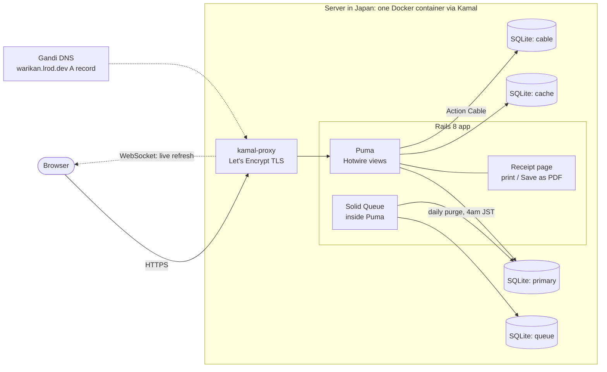
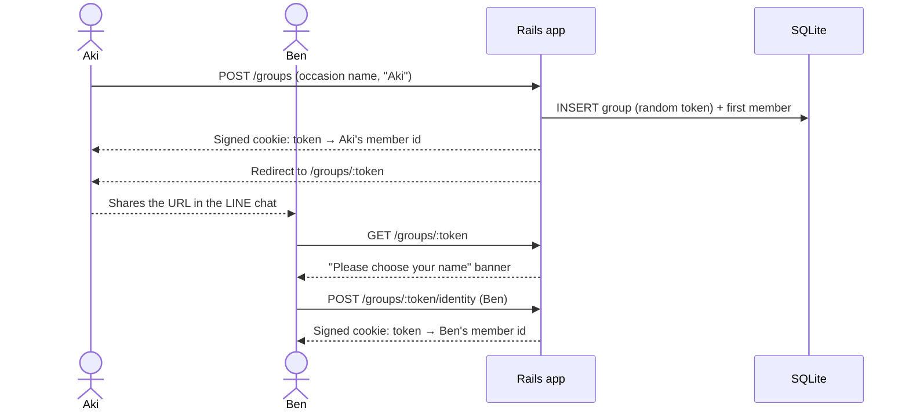

# Architecture

okanjo is a shared-expense splitting app for single occasions (a 飲み会, a trip). Users see
it as **warikan (割り勘)** at `warikan.lrod.dev`; okanjo is the codebase name (ADR 0017).
Decisions are recorded in [`docs/adr/`](adr/README.md), and this document summarises them.

**Status (2026-11-13):** the core is built, tested and **live at https://warikan.lrod.dev**:
the domain model, the core flow, balances, settlement, live refresh, the printable receipt
and the purge job. Everything marked *planned* is designed but not implemented yet.

| Area | Status |
|---|---|
| Domain model: groups, members, expenses, split shares | built |
| Routes, controllers and forms (session 2) | built |
| Balance sheet, settlement, live refresh (session 3) | built |
| Printable receipt, purge job (session 4) | built |
| Deploy (session 4) | live since 2026-11-13 |
| Phase 2: auth generator, JSON API, LIFF client, LINE Login | planned, after the core ships |

## System context

- **One process, no Redis, no Node.** The Rails 8 defaults (Solid Queue, Solid Cache,
  Propshaft, importmap) keep the whole app in one container backed by SQLite files on a
  Docker volume (ADR 0002, 0017).
- **Server-rendered HTML.** ERB views with Turbo and Stimulus. No JSON API in the core
  (ADR 0003).
- **Live refresh.** Every change to an occasion broadcasts a Turbo page refresh over Action
  Cable (Solid Cable in production), and other viewers' pages morph in place (ADR 0019).
- **No login in the core.** An occasion's URL token is its only access control. A signed
  cookie remembers which member this browser is in each occasion (ADR 0005, 0006, 0016).

## Domain model

- **A group is one occasion.** Every calculation creates a new one, and members don't carry
  over between occasions (ADR 0004, 0005, 0006).
- **Shares aren't stored.** `participations` has no amount. Each share is the amount divided
  by the number of members in the split, rounded up (`Integer#ceildiv`). The payer is
  credited with what's collected and keeps the odd yen (お釣り): ¥1,000 split 3 ways is
  ¥334 each, ¥1,002 collected, ¥2 kept by the payer (ADR 0008).
- **The payer doesn't have to be in the split** (e.g. a non-drinker paying the drinks
  tab). Payer and split members must belong to the expense's group (ADR 0015).
- **Last change.** Members, expenses and split entries `touch` their parent, so
  `groups.updated_at` moves forward on any edit. That includes removing someone from a
  split, which needs `dependent: :destroy` on the `has_many :through`.

### Where the logic lives (ADR 0009)

| Logic | Lives in | Status |
|---|---|---|
| One expense's share, collected amount, odd yen | `Expense` model | built |
| A group's balances (credited minus owed, per member) | `BalanceSheet`, plain Ruby, 3 queries | built |
| Who pays whom | `Settlement`, plain Ruby, from the balances | built |

`BalanceSheet` and `Settlement` live in `app/models/` with no table: in Rails a model is a
domain object, with or without a database table, and the folder is autoloaded. That's the
Rails-core and 37signals habit, instead of inventing an `app/services/` convention.

## Key flows

### Create an occasion and share it *(built)*

- Every route is nested under the token, and every record is loaded through the occasion
  (`GroupScoped`), so another occasion's ids are a 404.
- The cookie is a convenience, not security: it defaults the payer and marks "you". It
  also lists this browser's recent occasions on the start page (`CurrentMember`).

### Add an expense and settle up *(built)*

1. Someone adds an expense: description (pre-filled 支払い N), amount, payer (defaults to
   this browser's member), and who's in the split (everyone by default). Leaving the payer
   out of the split asks for confirmation, stating the effect in yen (ADR 0015).
2. **Everyone viewing the occasion sees it.** The expense touches the group, the group
   broadcasts a Turbo refresh over Action Cable, and each viewer's page morphs in place.
   A `keep-edits` Stimulus controller stops the morph from wiping a field someone is
   typing in (ADR 0019).
3. **The 精算 (settle up) section** shows each member's fronted and owed amounts and
   balance (`BalanceSheet`, 3 queries whatever the size), then who pays whom.
   **Settlement goes through one collector:** the member with the largest positive
   balance (ties go to whoever joined first). Every other member makes at most one
   transfer, to or from the collector. That's at most n−1 transfers, chosen because
   people trust "pay the 幹事", not because it's the fewest possible (ADR 0013).

### Retention and the purge job *(built)*

- An occasion is deleted **30 days after its last change**. Viewing doesn't count. The
  occasion page shows the deletion date, and the printable receipt is how users keep a
  record (ADR 0016).
- `PurgeStaleGroupsJob` runs as a Solid Queue recurring task (`config/recurring.yml`,
  `every day at 4am Asia/Tokyo`, production only). It runs `Group.stale.delete_all`: one
  `DELETE` statement, with the children removed by the database cascades (ADR 0012).
- `Group.stale` is strictly older than 30 days (`...RETENTION.ago`), so an occasion is never
  deleted before the date its page shows. A missed run catches up the next day.

### The receipt *(built)*

`GET /groups/:token/receipt` shows every expense with who was in its split, the total,
the balances and the transfers, laid out for paper. A Stimulus `print` controller calls
`window.print()`, Tailwind `print:` variants hide the app's header and buttons, and the
browser's "Save as PDF" produces the file, with no PDF gem (ADR 0016).

### Two deletion routes

| Route | Used by | How children go | Callbacks |
|---|---|---|---|
| `group.destroy` | user-triggered deletes | `dependent: :destroy`, expenses before members | run |
| `delete_all` | the purge job | database `ON DELETE CASCADE` | skipped, deliberately |

A member who paid for something or is in a split can't be deleted on their own
(`restrict_with_error`).

## Deployment and CI

- **Deploy *(live)*:** Kamal 2 to Oracle Cloud Always Free (ARM: 1 OCPU, 6 GB, Osaka), on an
  account upgraded to pay-as-you-go to get capacity, with a 0円 budget alert (ADR 0017).
  `bin/kamal deploy` builds the image natively on the Mac, pushes it to GitHub Container
  Registry (`ghcr.io/luisrrv/okanjo`), and the server pulls it. kamal-proxy terminates TLS
  with a Let's Encrypt certificate and redirects HTTP to HTTPS; HSTS is on.
- **Server:** Ubuntu 24.04, Docker from Ubuntu's own package, ports 80/443 opened in both
  the VCN security list and the server's iptables. Kamal connects as `ubuntu` with a
  dedicated SSH key. The registry token lives in the macOS keychain.
- **Footprint at launch:** the app container uses about 270 MB and kamal-proxy about 8 MB,
  1.0 GB of the server's 5.8 GB in total. A cached deploy takes about a minute.
- **Database:** SQLite files in `storage/` on a Docker volume, with separate databases for
  primary data, the cache and the queue.
- **Backups:** Litestream, running inside Puma, streams the primary database to a private
  Oracle Object Storage bucket every minute and keeps 7 days (ADR 0020). A restore drill
  on 2026-11-13 matched the live database; the runbook is in `docs/specs/backups.md`.
- **Seeds:** the night-out demo, for development and test only. `db:prepare` would
  otherwise seed a fresh production database.
- **CI:** GitHub Actions runs Brakeman, bundler-audit, the importmap audit, RuboCop, RSpec,
  and system specs in headless Chrome. `bin/ci` runs the same checks locally (ADR 0014).

## Phase 2 *(planned, after the core ships)*

1. The Rails 8 auth generator (email + password, sessions) and a nullable
   `Member.user_id`.
2. A JSON API next to the HTML app.
3. A small LIFF client, likely served from a path on the same domain so it shares session
   cookies.
4. LINE Login as a second strategy on the same `User`, reusing the generator's session code.

This needs its own ADR first. The core keeps running on its own (ADR 0016, 0017).
